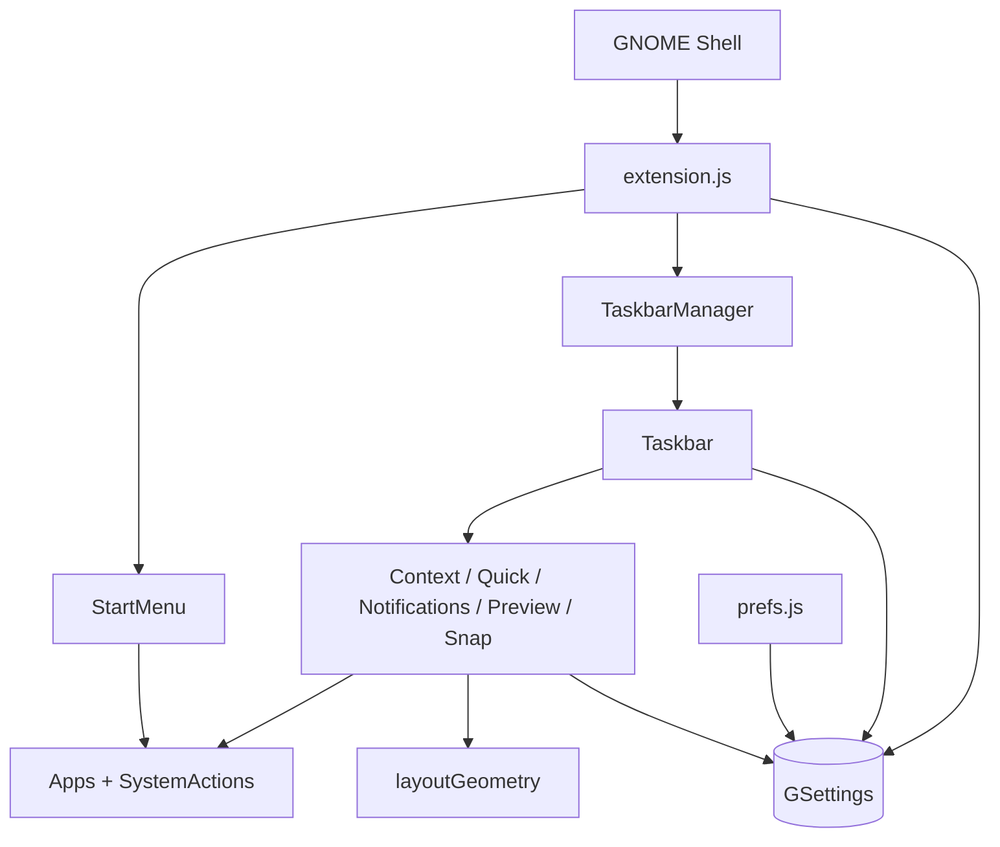

# Arquitetura

## Estilo geral

WinShell é uma extensão monolítica do GNOME Shell, sem servidor próprio e sem
persistência fora de GSettings. O Shell carrega `extension.js`, que obtém as
configurações e instancia o menu e o gerenciador de barras (`extension.js:40-50`).
O processo de preferências é outro ponto de entrada e liga widgets GTK diretamente
às mesmas chaves (`prefs.js:6-37`).

## Blocos e responsabilidades

| Bloco | Responsabilidade |
|---|---|
| Ciclo de vida | Habilitar/desabilitar e preservar a visibilidade anterior do painel (`extension.js:40-76`) |
| Composição por monitor | Criar e reconstruir barras (`modules/multiMonitor.js:4-29`) |
| Barra de tarefas | Orquestrar apps, flyouts, relógio e eventos (`modules/taskbar.js:14-74`) |
| Superfícies | Implementar menu Iniciar, contexto, quick settings, notificações, previews e snap sobre `PopupSurface` (`modules/popup.js:6-55`) |
| Integração GNOME | Consultar apps, chamar `.desktop`, alterar settings e abrir menus nativos (`modules/apps.js:3-25`, `modules/systemActions.js:4-38`) |
| Preferências e dados | Expor UI GTK e persistir no schema (`prefs.js:7-37`, `schemas/org.gnome.shell.extensions.winshell.gschema.xml:3-15`) |
| Geometria | Manter cálculo puro separado da UI (`modules/layoutGeometry.mjs:1-23`) |

## Dependências entre blocos

Evidências de cada seta:

- GNOME → entrada: `Extension` é a classe-base de `WinShellExtension`
  (`extension.js:1`, `extension.js:40`).
- entrada → menu/gerenciador: imports e construção (`extension.js:3-4`,
  `extension.js:45-47`).
- gerenciador → barra: import e construção (`modules/multiMonitor.js:2`,
  `modules/multiMonitor.js:17-21`).
- barra → flyouts: imports e instâncias (`modules/taskbar.js:7-12`,
  `modules/taskbar.js:31-35`).
- menu/flyouts → integrações: `StartMenu` usa apps e ações
  (`modules/startMenu.js:4-6`); quick settings usa ações do sistema
  (`modules/quickSettings.js:3-4`).
- snap → geometria: import e conversão da área (`modules/snapLayouts.js:6`,
  `modules/snapLayouts.js:8-17`).
- preferências → GSettings: bindings GTK (`prefs.js:8`, `prefs.js:23-33`).
- runtime → GSettings: entrada obtém settings (`extension.js:42`) e barra reage a
  mudanças (`modules/taskbar.js:62-65`); menus leem/escrevem chaves
  (`modules/contextMenu.js:18-25`).

## Camadas internas

1. **Integração de plataforma:** `extension.js`, `apps.js` e `systemActions.js`
   acessam APIs do Shell/GI (`extension.js:1-4`, `modules/apps.js:1-6`,
   `modules/systemActions.js:1-10`).
2. **Orquestração:** `TaskbarManager` decide quantas barras existem e `Taskbar`
   coordena os componentes (`modules/multiMonitor.js:14-22`,
   `modules/taskbar.js:14-74`).
3. **Apresentação:** atores `St` e estilos formam barra e popups
   (`modules/popup.js:7-12`, `stylesheet.css:1-18`).
4. **Domínio geométrico puro:** `layoutGeometry.mjs` não importa GNOME e retorna
   retângulos ou `null` (`modules/layoutGeometry.mjs:1-23`).

## Comunicação e estado

Não existe comunicação de rede no código inspecionado. A comunicação é local:
chamadas ES modules; sinais do Shell/GObject; e GSettings. O runtime observa
mudanças de configuração (`modules/taskbar.js:62-65`,
`modules/multiMonitor.js:10-12`) e eventos de apps, foco e monitores
(`modules/taskbar.js:66-73`). A preferência `pinned-apps` é a lista persistente
manipulada tanto pela UI GTK (`prefs.js:30-34`) quanto pelo menu contextual
(`modules/contextMenu.js:20-25`).

## Decisões observáveis

- Os flyouts são atores regulares adicionados como chrome, sem usar internals de
  popup menu (`modules/popup.js:5-12`).
- Notificações são uma visão somente leitura e limitada às fontes expostas pelo
  Shell (`modules/notificationCenter.js:7-23`).
- Controles completos de áudio/rede/calendário são delegados aos menus nativos
  (`modules/systemActions.js:32-38`).
- Uma barra é recriada ao mudar monitores ou `multi-monitor`, em vez de ser
  mutada incrementalmente (`modules/multiMonitor.js:10-22`).
- O cálculo de layout é síncrono; a única espera explícita da interface é o atraso
  de 450 ms da pré-visualização (`modules/windowPreview.js:62-68`).
- Não há banco de dados nem serviço remoto; persistência observável ocorre em
  schemas GSettings (`modules/systemActions.js:4-5`,
  `schemas/org.gnome.shell.extensions.winshell.gschema.xml:3-15`).

## Pendências

- TODO: validar o ciclo de vida dos atores e sinais sob reload/falha parcial em
  uma sessão GNOME 46 real.
- TODO: confirmar se `Main.messageTray.getSources()` está disponível de forma
  estável na versão alvo.
- TODO: medir o custo de reconstruir todas as barras em mudanças de monitor.

