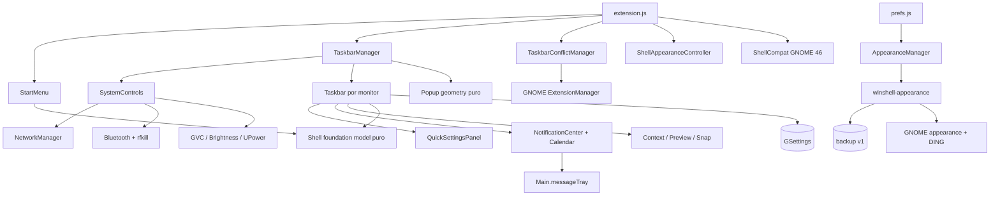

# Arquitetura

## Visão geral

WinShell combina uma extensão GJS/ES Modules com pacotes visuais independentes e um helper de aparência executado somente pelas preferências. `extension.js` coordena o lifecycle; `TaskbarManager` cria as barras; atores `St` formam a apresentação. O backup JSON é o único armazenamento externo ao GSettings.

## Camadas

| Camada | Módulos |
|---|---|
| Lifecycle/topologia | `extension.js`, `multiMonitor.js`, `taskbar.js`, `taskbarConflict.js` |
| Compatibilidade GNOME 46 | `shellCompat.js`, único ponto para Main/MessageTray/GVC/Slider/ExtensionManager/chrome |
| Plataforma | `systemControls.js`, `systemActions.js`, `apps.js` |
| Apresentação | Quick Settings, calendário, notificações, contexto, Start, previews e Snap |
| Domínio puro | `shellFoundationModel.mjs`, `calendarModel.mjs`, `notificationModel.mjs`, `quickSettingsModel.mjs`, `windowActions.mjs`, `layoutGeometry.mjs`, `popupGeometry.mjs`, `taskbarConflictModel.mjs`, `taskbarGeometry.mjs` |
| Persistência/configuração | schema GSettings e `prefs.js` |
| Aparência do Shell | `modules/appearance/theme.js`, CSS gerado e tokens |
| Aplicação reversível | `modules/appearance/manager.js`, `integrations/appearance/winshell-appearance` |
| Recursos independentes | `themes/`, `icons/`, `wallpapers/` |
| Integrações opcionais | `integrations/desktop/`, `integrations/nautilus/` |

## Integrações

- NetworkManager é inicializado por `NM.Client.new_async`; scans e ativações também são assíncronos.
- Bluetooth usa gnome-bluetooth e o proxy de rfkill do Settings Daemon.
- Áudio reutiliza o singleton GVC do próprio GNOME Shell; não abre uma segunda conexão de mixer.
- Brilho e UPower são proxies D-Bus construídos de forma assíncrona.
- Tema e Não Perturbe usam GSettings e recebem mudanças externas.
- Notificações continuam sob autoridade de `Main.messageTray`; acesso a
  MessageTray e demais módulos JavaScript específicos da versão alvo passa por
  `shellCompat.js`. Sinais e callbacks internos são detectados antes do uso e
  degradam para estado não acionável quando ausentes.
- Conflitos são identificados por `Main.extensionManager.lookup()` e alterados somente por `disableExtension()`/`enableExtension()`; atores de terceiros nunca são destruídos.
- Light/Dark do Shell é uma classe no `uiGroup`, removida no disable; o runtime não escreve preferências globais.
- O helper captura o valor original antes de cada primeira alteração, registra o último valor aplicado e recusa divergências externas sem `--force`.
- Nautilus usa somente `Nautilus.MenuProvider`; DING usa somente chaves existentes no schema público.

## Lifecycle

O adaptador global agenda no máximo um idle de atualização e guarda cada conexão de sinal. Destruição remove o idle, sinais dinâmicos de AP/device/sink e assinantes. Cada centro de notificação desconecta tray/sources/items; cada popup desconecta stage, devolve foco e remove explicitamente seu chrome; previews removem timeouts. Construção e rebuild parcial das barras fazem rollback se falharem. O gerenciador de conflitos também usa um único idle e distingue disable real do rebase transitório do GNOME 46, restaurando docks apenas no lifecycle real.

## Decisões

- Nenhuma chamada D-Bus síncrona foi adicionada à thread do Shell.
- Serviços ausentes não derrubam deliberadamente os outros controles.
- Redes novas, pareamento e configuração avançada permanecem no GNOME Settings.
- O calendário WinShell não modifica nem substitui objetos do calendário nativo.
- Modelos puros separam cálculos/normalização da UI GJS.
- Geometria de popup seleciona o monitor e limita superfícies em coordenadas lógicas, incluindo origens negativas e âncoras fracionárias.
- `addChrome` mantém a barra abaixo de janelas/popups, `affectsStruts` reserva área útil e `trackFullscreen` a oculta por monitor em fullscreen.
- Tokens em `themes/design-tokens.json` geram o CSS da extensão, os temas GTK/Shell, ícones e wallpapers reproduzíveis.
- Libadwaita não recebe injeção de CSS; seus limites são preservados.

## Compatibilidade

O código e os imports têm como alvo GNOME Shell 46/Ubuntu 24.04, principalmente Wayland. Sintaxe e modelos foram testados; comportamento visual ainda não foi homologado em uma sessão gráfica descartável.

