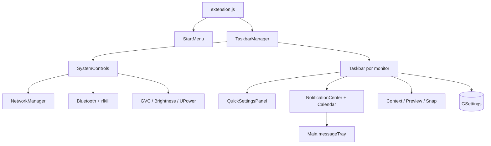

# Arquitetura

## Visão geral

WinShell é uma extensão GJS/ES Modules sem daemon ou armazenamento próprio. `extension.js` coordena o lifecycle; `TaskbarManager` possui um adaptador de sistema compartilhado e cria as barras; atores `St` formam a apresentação.

## Camadas

| Camada | Módulos |
|---|---|
| Lifecycle/topologia | `extension.js`, `multiMonitor.js`, `taskbar.js` |
| Plataforma | `systemControls.js`, `systemActions.js`, `apps.js` |
| Apresentação | Quick Settings, calendário, notificações, contexto, Start, previews e Snap |
| Domínio puro | `calendarModel.mjs`, `notificationModel.mjs`, `quickSettingsModel.mjs`, `windowActions.mjs`, `layoutGeometry.mjs` |
| Persistência/configuração | schema GSettings e `prefs.js` |

## Integrações

- NetworkManager é inicializado por `NM.Client.new_async`; scans e ativações também são assíncronos.
- Bluetooth usa gnome-bluetooth e o proxy de rfkill do Settings Daemon.
- Áudio reutiliza o singleton GVC do próprio GNOME Shell; não abre uma segunda conexão de mixer.
- Brilho e UPower são proxies D-Bus construídos de forma assíncrona.
- Tema e Não Perturbe usam GSettings e recebem mudanças externas.
- Notificações continuam sob autoridade de `Main.messageTray`; a extensão usa seus sinais e métodos públicos da versão alvo.

## Lifecycle

O adaptador global agenda no máximo um idle de atualização e guarda cada conexão de sinal. Destruição remove o idle, sinais dinâmicos de AP/device/sink e assinantes. Cada centro de notificação desconecta tray/sources/items; cada popup desconecta stage; previews removem timeouts. A construção do gerenciador faz rollback se falhar.

## Decisões

- Nenhuma chamada D-Bus síncrona foi adicionada à thread do Shell.
- Serviços ausentes não derrubam deliberadamente os outros controles.
- Redes novas, pareamento e configuração avançada permanecem no GNOME Settings.
- O calendário WinShell não modifica nem substitui objetos do calendário nativo.
- Modelos puros separam cálculos/normalização da UI GJS.

## Compatibilidade

O código e os imports têm como alvo GNOME Shell 46/Ubuntu 24.04, principalmente Wayland. Sintaxe e modelos foram testados; comportamento visual ainda não foi homologado em uma sessão gráfica descartável.

