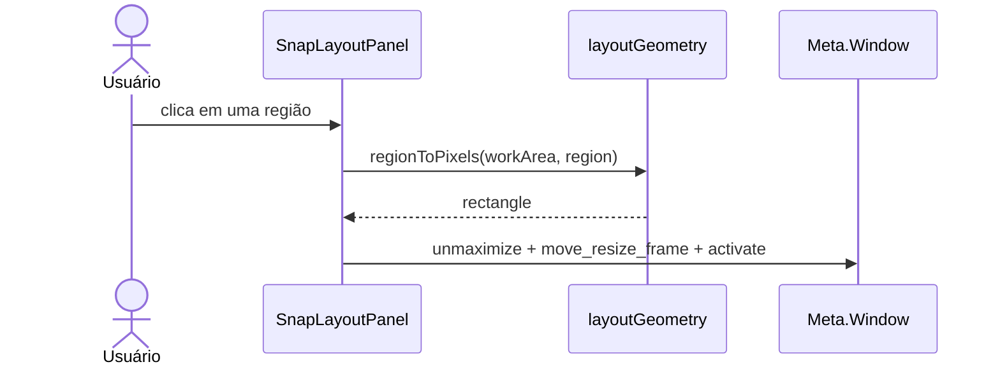

# Fluxos e casos de uso

## Atores

| Ator | Papel | Evidência |
|---|---|---|
| GNOME Shell | Carrega/descarrega a extensão e fornece APIs/eventos | `extension.js:1-4`, `extension.js:40-76` |
| Usuário | Clica, pesquisa, escolhe layouts e edita preferências | `modules/taskbar.js:98-107`, `modules/startMenu.js:38-45`, `prefs.js:12-35` |
| Compositor/`Meta.Window` | Executa foco, minimização, fechamento e geometria | `modules/taskbar.js:140-153`, `modules/snapLayouts.js:8-18` |
| GSettings | Persiste preferências da extensão e desktop | `prefs.js:23-33`, `modules/systemActions.js:4-5` |
| Sistema operacional | Fornece comandos usados por instalação/diagnóstico | `scripts/install.sh:6-19`, `scripts/doctor.sh:4-12` |

## UC-01 — Habilitar a extensão

**Ator:** GNOME Shell. **Entrada:** chamada `enable()`.

1. Obtém GSettings e registra a visibilidade atual do painel
   (`extension.js:41-43`).
2. Cria controller do painel e menu Iniciar (`extension.js:44-46`).
3. Cria `TaskbarManager`, que conecta sinais e reconstrói as barras
   (`extension.js:47`, `modules/multiMonitor.js:4-22`).
4. Observa a preferência do painel e aplica seu estado (`extension.js:48-50`).

**Dependências:** GNOME Shell, GSettings e módulos locais. **Persistência:** apenas
leitura neste fluxo. **Rede:** nenhuma. **Saída:** atores da extensão ativos.

## UC-02 — Falha ao habilitar

**Ator:** GNOME Shell. **Entrada:** exceção em qualquer construção do UC-01.

1. Registra literalmente ``[WinShell] Falha ao iniciar: ${error.stack ?? error}``
   (`extension.js:51-52`).
2. Chama `disable()` para destruir objetos já criados e restaurar o painel
   (`extension.js:53`, `extension.js:63-76`).
3. Relança a exceção ao Shell (`extension.js:54`).

**Persistência/rede:** nenhuma. **Saída:** extensão não habilitada e erro propagado.

## UC-03 — Pesquisar e abrir aplicativo

**Ator:** usuário. **Entrada:** clique em Iniciar/Pesquisar e texto opcional.

1. A barra calcula a âncora e abre/focaliza o menu (`modules/taskbar.js:98-107`).
2. O menu limpa o termo ao abrir, obtém apps instalados visíveis e os ordena
   (`modules/startMenu.js:51-65`, `modules/startMenu.js:88-92`,
   `modules/apps.js:9-14`).
3. Filtra nome, descrição, executável e keywords; renderiza até 100 resultados
   (`modules/startMenu.js:56-67`).
4. Clique ou Enter no primeiro resultado chama `activateApp` e fecha o menu
   (`modules/startMenu.js:38-45`, `modules/startMenu.js:80-82`).
5. O app ativa a primeira janela existente ou inicia o aplicativo
   (`modules/apps.js:21-25`).

**Dependências:** `Shell.AppSystem`, metadados `.desktop`. **Persistência/rede:**
nenhuma. **Saída:** app ativado/lançado.

## UC-04 — Pesquisa sem resultado

**Ator:** usuário. **Entrada:** termo que não está em nenhum campo pesquisável.

1. O filtro produz `_matches` vazio (`modules/startMenu.js:56-65`).
2. A UI mostra literalmente `Nenhum aplicativo encontrado`
   (`modules/startMenu.js:84-85`).
3. Pressionar Enter não ativa nada porque `first` é ausente
   (`modules/startMenu.js:38-45`).

**Persistência/rede:** nenhuma. **Saída:** menu permanece aberto, sem app ativado.

## UC-05 — Fixar ou desafixar aplicativo

**Ator:** usuário. **Entrada:** botão secundário em app e ação contextual.

1. A barra abre `ContextMenu.forApp` com o app selecionado
   (`modules/taskbar.js:154-160`).
2. O menu determina se o ID está em `pinned-apps` e mostra `Desafixar da barra`
   ou `Fixar na barra` (`modules/contextMenu.js:18-22`).
3. Ao clicar, remove ocorrências do ID; para fixar, anexa o ID
   (`modules/contextMenu.js:22-25`).
4. Escreve `pinned-apps`; o sinal `changed` causa rerender da barra
   (`modules/contextMenu.js:25`, `modules/taskbar.js:62-65`).

**Dependências:** GSettings. **Persistência:** sim, `pinned-apps`. **Rede:** nenhuma.
**Saída:** app adicionado/removido da lista visual, se o ID resolver.

## UC-06 — ID fixado não resolvido

**Ator:** runtime/GSettings. **Entrada:** ID inexistente em `pinned-apps`.

1. `appById(id)` retorna o resultado de `lookup_app` (`modules/apps.js:5-6`).
2. A barra só adiciona se `app` for truthy, portanto omite o ID inválido
   (`modules/taskbar.js:133-136`).

**Persistência:** o ID inválido permanece no GSettings; não há limpeza no código
inspecionado. **Rede:** nenhuma. **Saída:** nenhum botão e nenhuma mensagem de erro.

## UC-07 — Posicionar janela com Snap Layout

**Ator:** usuário e compositor. **Entrada:** janela válida + clique em região.

1. Usuário abre snap pelo contexto do app ou pelo preview
   (`modules/contextMenu.js:28-31`, `modules/windowPreview.js:40-49`).
2. O painel valida a janela e monta cinco templates/regiões clicáveis
   (`modules/snapLayouts.js:30-50`, `modules/layoutGeometry.mjs:3-9`).
3. O clique fecha o painel e chama `applyLayout(win, region)`
   (`modules/snapLayouts.js:51-58`).
4. A função valida janela e converte a região usando a work area do monitor
   (`modules/snapLayouts.js:8-13`).
5. Desmaximiza, move/redimensiona e ativa a janela
   (`modules/snapLayouts.js:14-18`).

**Dependências:** compositor GNOME/Meta. **Persistência/rede:** nenhuma.
**Saída:** `true` e janela na região solicitada.

## UC-08 — Janela não aceita Snap Layout

**Ator:** usuário/compositor. **Entrada:** janela ausente, imóvel, não
redimensionável, fullscreen, região inválida ou exceção do compositor.

1. Se a janela falha nas pré-condições, o painel exibe literalmente
   `Esta janela não pode ser reorganizada.` (`modules/snapLayouts.js:33-38`).
2. Se a falha ocorre ao aplicar, `applyLayout` retorna `false`; uma exceção também
   produz o log literal ``[WinShell] Could not snap window: ${error}``
   (`modules/snapLayouts.js:8-22`).
3. O clique que recebe `false` notifica literalmente
   `O aplicativo não aceitou o posicionamento solicitado.`
   (`modules/snapLayouts.js:54-58`).

**Persistência/rede:** nenhuma. **Saída:** janela inalterada ou resultado parcial
do compositor; UI informa falha.

## UC-09 — Alterar preferências

**Ator:** usuário. **Entrada:** switch, altura ou lista separada por vírgulas.

1. A janela liga switches/altura diretamente às chaves GSettings
   (`prefs.js:12-29`).
2. Para apps fixados, divide por vírgula, aplica trim, remove vazios e grava a
   lista (`prefs.js:30-34`).
3. Runtime observa mudanças: barra rerenderiza ou gerenciador reconstrói barras
   (`modules/taskbar.js:62-65`, `modules/multiMonitor.js:10-12`).

**Persistência:** sim, GSettings. **Rede:** nenhuma. **Saída:** configuração
aplicada imediatamente conforme o sinal observado.

## UC-10 — Entrada de preferência fora da UI

**Ator:** usuário/ferramenta externa de GSettings. **Entrada:** valor que não passa
pela UI GTK.

O schema rejeita tipo incorreto e restringe `panel-height` a `40..88`
(`schemas/org.gnome.shell.extensions.winshell.gschema.xml:4`). Para strings em
`pinned-apps`, o schema não impõe validade de IDs
(`schemas/org.gnome.shell.extensions.winshell.gschema.xml:14`); IDs inexistentes
são silenciosamente omitidos no runtime (`modules/taskbar.js:133-136`). Não há
mensagem própria da extensão neste caminho.

## UC-11 — Instalar localmente

**Ator:** usuário/sistema operacional. **Entrada:** `./scripts/install.sh`.

1. Exige `gnome-shell` e versão major 46 (`scripts/install.sh:6-12`).
2. Exige `glib-compile-schemas` (`scripts/install.sh:13-15`).
3. Cria o destino, copia fontes/módulos/schemas e compila o schema
   (`scripts/install.sh:16-19`).
4. Imprime destino e instruções de enable/preferências (`scripts/install.sh:20-23`).

**Persistência:** arquivos sob XDG data home. **Rede:** nenhuma. **Saída:** extensão
copiada e schema compilado.

## UC-12 — Pré-condição de instalação ausente

**Ator:** sistema operacional. **Entrada:** UC-11 sem GNOME, com versão diferente
ou sem compilador de schemas.

O script encerra no primeiro caso aplicável com uma das mensagens literais:
`ERRO: GNOME Shell não detectado. Execute no Ubuntu com GNOME.`,
`ERRO: Esta versão foi criada para GNOME 46 (detectado: ...).` ou
`ERRO: instale libglib2.0-dev-bin.` (`scripts/install.sh:6-15`). Como as validações
precedem `mkdir`, não há escrita no destino por esse script antes do erro
(`scripts/install.sh:6-16`).

## Matriz resumo

| UC | Ator principal | Persistência | Rede | Par feliz/erro |
|---|---|---:|---:|---|
| UC-01 | GNOME Shell | não | não | UC-02 |
| UC-02 | GNOME Shell | não | não | erro de UC-01 |
| UC-03 | usuário | não | não | UC-04 |
| UC-04 | usuário | não | não | erro/vazio de UC-03 |
| UC-05 | usuário | GSettings | não | UC-06 |
| UC-06 | runtime | GSettings preexistente | não | erro silencioso de UC-05 |
| UC-07 | usuário/compositor | não | não | UC-08 |
| UC-08 | compositor | não | não | erro de UC-07 |
| UC-09 | usuário | GSettings | não | UC-10 |
| UC-10 | ferramenta externa | GSettings | não | erro/limite de UC-09 |
| UC-11 | usuário/SO | arquivos | não | UC-12 |
| UC-12 | SO | não | não | erro de UC-11 |

## Pendências

- TODO: adicionar UC específico para comportamento real de cada menu nativo após
  validação em GNOME 46.
- TODO: confirmar se instalação parcialmente copiada pode ocorrer em falha de
  `cp` ou `glib-compile-schemas` e documentar recuperação.
- TODO: validar os fluxos UC-01, UC-03, UC-05, UC-07 e UC-09 em sessão gráfica.

